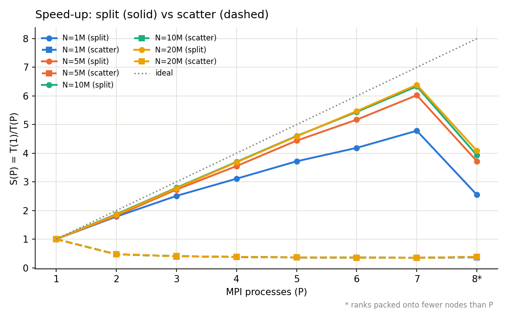
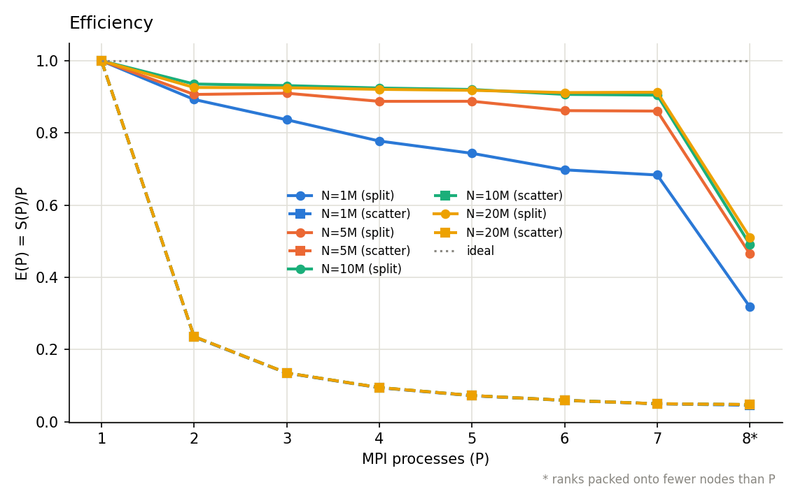
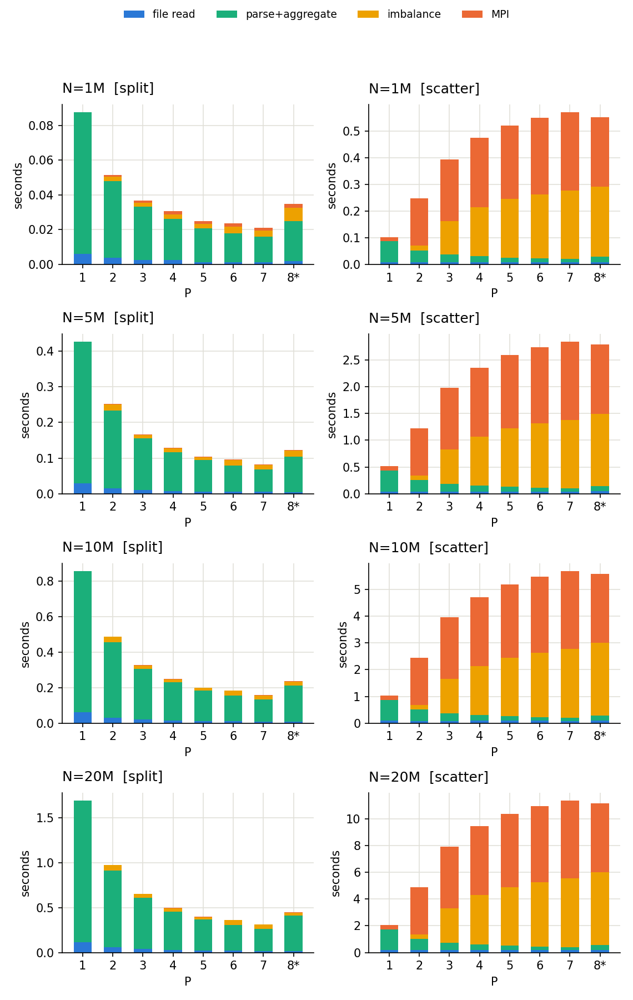

# 01 - Batch: server-log analytics with MPI

The batch implementation of the Scaling Log Analytics workload: a C++17 + MPI program that reads a
server access log and produces a fixed report, with a sequential C++ program as the correctness
reference.

## Workload

Input: a header line `N K S`, then `N` lines of

```
timestamp server_id endpoint_id user_id status_code response_time bytes_sent
```

`S` is the number of servers (`server_id` in `[0, S-1]`), `K` the length of the rankings. A request
is successful if `status_code < 400`. The report has total / successful / failed counts; average,
min and max response time; total bytes; 2xx / 3xx / 4xx / 5xx counts; the busiest 60-second interval
(`timestamp / 60`); and the top-`K` servers (by request count, with average response time) and
top-`K` endpoints (by request count, with total bytes). Ties go to the smallest id. The exact
output format is in `tests/*.expected`.

Edge-case conventions, each with a fixture in `tests/`:

| Case | Behaviour | Fixture |
|---|---|---|
| `1xx` status | successful (`< 400`), in no `STATUS_*` bucket | `edge_status` |
| `199` / `599` | `199` is 1xx, `599` is `STATUS_5XX` | `edge_status` |
| status `>= 600` | failed, in no bucket | - |
| busiest-interval or top-`K` tie | smallest id wins | `ties` |
| `K` larger than the number of ids | the list is simply shorter | `single` |
| blank / malformed lines | blank skipped; malformed counted, warned on stderr, excluded | - |
| response-time output | fixed at 6 decimal places | - |

Hard limits the code checks instead of mis-handling: `sum(response_time) * 10^6` must fit in `int64`;
`--io scatter` handles at most 2 GB (`MPI_Scatterv` counts are `int`); timestamps may span at most
10^7 intervals.

## Design

**Bit-exact at any P.** Response times are accumulated as scaled 64-bit integers (microseconds),
never `double`. Floating-point addition is not associative, so a `double` accumulator would make the
average depend on `P` and on the order of summation. With integers, the MPI output is byte-identical
to the sequential output for every `P` and both I/O modes.

**Two data-distribution strategies (both measured).**

| | `--io split` (default) | `--io scatter` |
|---|---|---|
| Who reads | every rank reads its own byte range | rank 0 reads the whole file |
| Distribution | none; the shared filesystem is the fan-out | `MPI_Scatterv` of raw bytes |
| Rank 0 memory | O(chunk) = 8 MB | O(file) |

`split` cuts the file into `P` byte ranges that rarely land on line boundaries. Rule: a rank owns every
line whose first byte lies in its range; a line straddling the upper bound is finished by the rank
that started it, and the next rank drops its leading partial line. `scatter` is kept as the contrast
case that makes the cost of naive distribution visible.

**Aggregate before communicating.** Each rank builds a partial aggregate of size
O(servers + endpoints + distinct intervals), never O(N). Scalars use one `MPI_Reduce`; min/max use
`MIN`/`MAX` reductions with identity values for empty ranks; per-server and per-endpoint vectors and a
densified interval histogram use `SUM` reductions. Reduction volume is independent of N, so
communication stays flat while computation grows.

**Global top-K once.** Top-`K` and the busiest interval are chosen on rank 0 after the reduction, so the
tie-break rules are applied exactly once to global counts.

**Timing.** A barrier before each timed communication region separates `TIME_COMM` (data movement)
from `TIME_IMBALANCE` (straggler wait). `TIME_SOLVE` (read + parse + aggregate + reduce, max over
ranks) is the speed-up metric. Timings go to stderr, the report to stdout or a file.

## Results

Generated from [`results/benchmark.csv`](results/benchmark.csv) by `scripts/plot.py`; the full tables
(time, speed-up, efficiency, throughput, % time in MPI, load imbalance, split vs scatter, sequential
baseline) are in [`results/summary.md`](results/summary.md).

Measurement setup: one MPI rank per node (`P` is also the number of machines, so communication is real
network traffic), 7 nodes, `P = 1..7`. `P = 8` is 2 ranks on each of 4 nodes, flagged with `8*` in the
tables and plots because it is not comparable with the one-per-node points.

N = 20M records, `--io split`:

| P | 1 | 2 | 3 | 4 | 5 | 6 | 7 | 8* |
|---|:---:|:---:|:---:|:---:|:---:|:---:|:---:|:---:|
| time (s) | 1.692 | 0.914 | 0.610 | 0.459 | 0.369 | 0.309 | 0.265 | 0.414 |
| speed-up | 1.00 | 1.85 | 2.78 | 3.68 | 4.59 | 5.47 | 6.39 | 4.09 |
| efficiency | 1.00 | 0.93 | 0.93 | 0.92 | 0.92 | 0.91 | 0.91 | 0.51 |



- `split` reaches 6.39x at P=7 (N=20M) with efficiency 0.91, and efficiency improves with input size
  (0.68 at N=1M to 0.91 at N=20M, P=7) because reduction volume is independent of N. Peak throughput is
  2,862 MB/s; time inside MPI calls is 0.6% of runtime at N=20M, P=7.
- `scatter` is slower than `split` at every `P > 1` and gets worse as `P` grows: 24.12x slower at
  N=20M, P=7 (1.32x at P=1). Rank 0 pushes `(P-1)/P` of the file through a single sender.
- Load imbalance (straggler wait at the barrier, not data transfer) is the visible cost of scaling out;
  it reaches roughly 17-20% of runtime at P=6-7.
- Packed `P=8` falls below the one-per-node trend (6.39x to 4.09x): co-resident ranks share one machine's
  memory bandwidth and page cache, and this workload is bandwidth-bound.




Correctness: the verification suite (fixtures, five generated datasets vs the sequential reference,
and cross-`P` / cross-mode determinism, at `P = 1..8` in both I/O modes) passed 150 / 150 in the
cluster run. Raw job logs are not included in this repository.

## Layout

```
Makefile                build / verify / bench / plot targets
src/loganalytics.hpp    parsing, aggregation, top-K, report printing (shared, so output is identical by construction)
src/loganalytics_seq.cpp  sequential program: correctness reference and single-core baseline
src/loganalytics_mpi.cpp  MPI program: I/O distribution + reductions
scripts/gen_logs.py     seeded dataset generator
scripts/verify.sh       correctness suite
scripts/benchmark.sh    sweep: size x P x I/O mode x reps -> CSV
scripts/plot.py         CSV -> results/summary.md + PNGs
slurm/                  sbatch wrappers (verify on one node, benchmark across nodes)
tests/                  hand-computed fixtures (tiny, ties, single, edge_status)
results/                benchmark.csv, summary.md, figures
```

## How to run

Build (needs an MPI C++ compiler; module names are cluster-specific, e.g. `module load <your-openmpi>`):

```bash
make            # bin/loganalytics_seq, bin/loganalytics_mpi
```

Run on one input:

```bash
./bin/loganalytics_seq tests/tiny.txt                       # report to stdout
mpirun -np 6 --map-by node --bind-to none \
       -x OMPI_MCA_coll_hcoll_enable=0 \
       ./bin/loganalytics_mpi tests/tiny.txt out.txt --io split
```

`--map-by node` puts one rank per node; `--bind-to none` and the `hcoll` flag were needed on the Open MPI
build used here and can be dropped on other systems. Use `mpirun`, not `srun`, if your MPI lacks PMI
wiring.

Generate a dataset (fully determined by `--seed`):

```bash
mkdir -p data
python3 scripts/gen_logs.py -n 10000000 -o data/logs_10000000.txt -k 10 --servers 64 --endpoints 512 --seed 42
```

The data are deliberately non-uniform: Zipf server/endpoint popularity, log-normal response times,
per-endpoint payload scales, and a burst of 4% of records into one 60-second window.

Verify and benchmark:

```bash
make verify                                  # local, no Slurm needed
PROCS="1 2 4" bash scripts/verify.sh         # smaller local sweep
sbatch slurm/verify.slurm                    # all ranks on one node
sbatch slurm/benchmark.slurm                 # N in {1M,5M,10M,20M} x P x {split,scatter} x 3 reps
```

The Slurm scripts use `--partition=debug` and a 6-7 node request; adjust the partition, node count and
module setup for your cluster. `plot.py` falls back to writing only `summary.md` if matplotlib is
missing; run it again where matplotlib is available to regenerate the PNGs.
