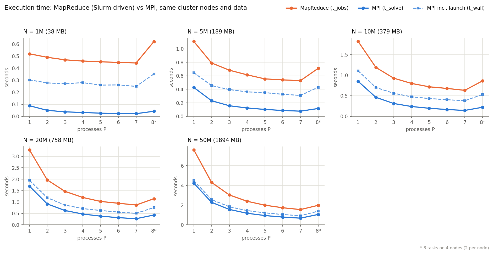
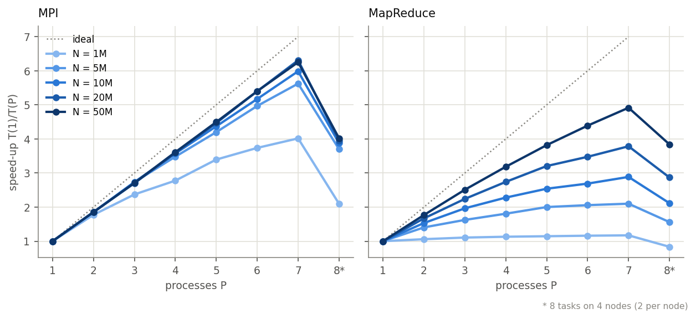
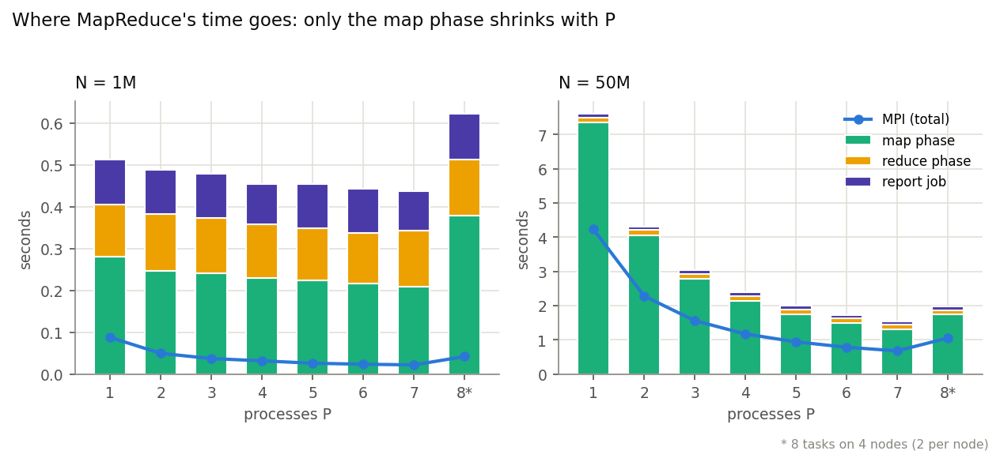
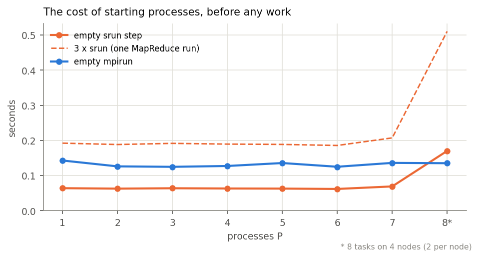
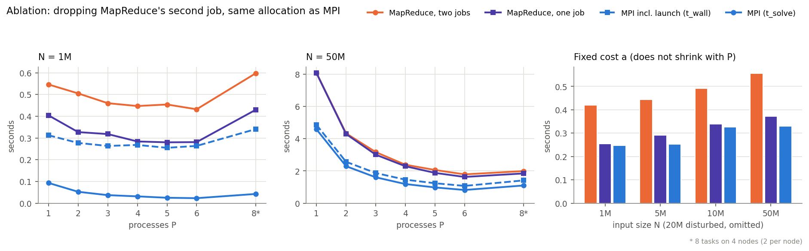
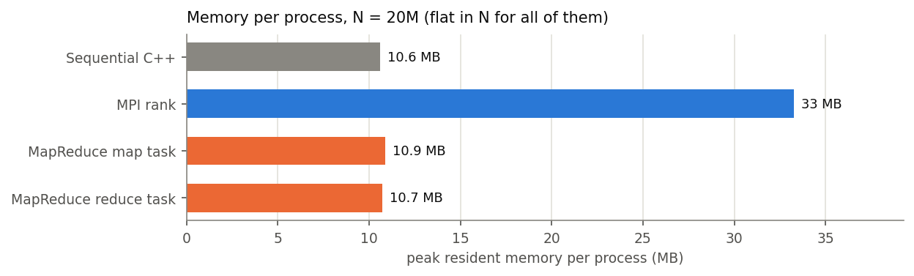
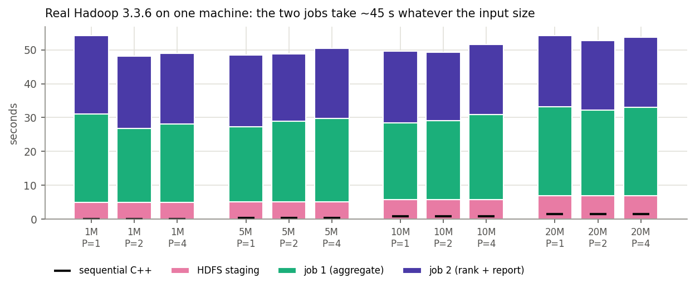
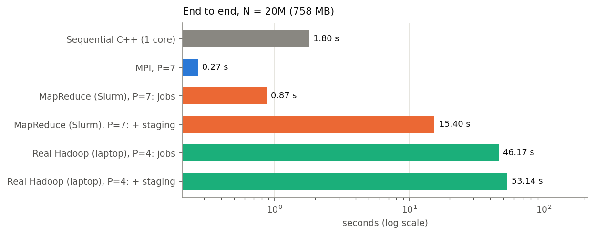

# 02 - MapReduce: the same analytics as Hadoop Streaming jobs

The server-log analytics workload from [`01-mpi`](../01-mpi) re-implemented as C++ Hadoop Streaming
programs (a mapper, a reducer/combiner and a report reducer), and compared with the MPI program on the
same nodes and the same data. The report is byte-identical to the sequential C++ reference in every
run.

## Summary

- **Correct everywhere.** 88 / 88 checks locally and 88 / 88 when every task goes through `srun`
  on 3 nodes; 48 / 48 for the single-job variant; 44 / 44 on real Hadoop; every one of 555 benchmark
  rows was byte-identical to the sequential program.
- **MPI is faster in every configuration:** 1.8-20x on its own timer, and a steady ~1.7x when process
  launch is counted on both sides.
- **MapReduce's gap has two parts.** A fixed ~0.45 s per run (three distributed steps, each starting
  processes with `srun` and passing data through the shared file system), and a slower scan (map tasks
  read their split over NFS; MPI reads from memory). Because the fixed part does not grow, MapReduce's
  parallel efficiency at P = 7 rises from 0.17 (1M records) to 0.70 (50M).
- **Ablation:** a single job instead of two saves ~0.13 s per run and brings the fixed cost within
  0.04 s of MPI's launch cost (within 1.1-1.3x of MPI at 1M); at 50M it is still ~1.5-1.7x slower
  because the gap there is the scan.

## Setup: Slurm simulation plus a real-Hadoop laptop run

The target was Hadoop 3.3.6 with YARN and Hadoop Streaming. On the university Slurm cluster used here
the shared Hadoop installation provides Hadoop 3.3.0 files, but its HDFS has **no DataNodes** (capacity
0, safe mode) and **no YARN ResourceManager** is configured
([`results/cluster/recon_hadoop.txt`](results/cluster/recon_hadoop.txt)), and installing Hadoop on the
shared cluster was not an option. So no MapReduce job could run there.

The mapper and reducers are ordinary Hadoop Streaming programs (stdin in, stdout out). **All multi-node
results below come from running those same binaries across the cluster with
[`scripts/run_slurm.sh`](scripts/run_slurm.sh), with Slurm standing in for Hadoop's services:**

| Hadoop service | In the Slurm runs |
|---|---|
| NameNode / DataNode (HDFS) | each input split is an ordinary file on the shared NFS `/home` |
| ResourceManager (YARN) | the Slurm allocation (`sbatch`) |
| NodeManager (YARN) | `srun` starting [`mr_task.sh`](scripts/mr_task.sh) on each node |
| ApplicationMaster | `run_slurm.sh`, which runs the phases in order |

The simulation has no data locality (every task reads over NFS, as the MPI ranks do), no task retries
and no Java start-up. The same binaries were also run under real Hadoop 3.3.6 on a laptop (see the end of
this file); one machine measures Hadoop's start-up cost, not MapReduce's scaling, so those results are
kept separate.

Datasets: `scripts/gen_logs.py -k 10 --servers 64 --endpoints 512 --seed 42`, N in
{1M, 5M, 10M, 20M, 50M} records (38 MB - 1.9 GB). The 1M-20M files are byte-identical to the 01-mpi
datasets (same md5); 50M is new. Placement: P = 1..7 processes, one per node; P = 8 runs 2 per node on
4 nodes and is marked `*`. MPI is the 01-mpi `loganalytics_mpi --io split`, unchanged, run in the same
Slurm job on the same nodes and files.

## Design

Two jobs:

```
JOB 1 - aggregate                           JOB 2 - rank and report
  map      mr_map     (P tasks)               map      identity
  combine  mr_reduce  (per map task)          reduce   mr_report  (exactly ONE task)
  reduce   mr_reduce  (R = 4 tasks)
```

`mr_map` parses its split with the shared `loganalytics.hpp` and folds every record into one in-memory
aggregate, then at end-of-input prints one line per key: `G:0` (global totals, 11 integer fields),
`S:<server>`, `E:<endpoint>`, `I:<interval>` and `H:<hostname>` (which machine ran the task). Lines are
partitioned by `hash(key) mod R`, sorted, and summed by `mr_reduce` (also the combiner). Job 2's single
reducer `mr_report` merges everything, picks the busiest interval and top-K, and prints the report with
the shared `print_report`.

| Decision | Why |
|---|---|
| **In-mapper combining**: each map task aggregates its whole split and emits once | A textbook mapper emits one pair per input line. `mr_map` emits ~2,019 lines per mapper at every N (64 servers + 512 endpoints + ~1,441 intervals + 2); at P = 7, 20M records shuffle as 14,133 lines (333 KB). This mirrors what MPI does before its `MPI_Reduce` |
| `mr_reduce` is also the combiner | Safe only for associative, commutative operations (sum, min, max) whose output format equals their input format; Hadoop may run a combiner 0, 1 or many times |
| **Second job with exactly one reducer** | Ranking must be global; with R reducers each holds an arbitrary subset of keys, and a local top-K is not the global top-K |
| Zero-padded ids (`S:0000000007`) | The shuffle sorts keys as bytes; unpadded, `"10"` sorts before `"9"` and a key's lines would not be adjacent |
| Everything is int64 (times in microseconds) | Sums are exact, so the answer does not depend on the number of mappers or reducers, or on how often the combiner ran; every test can demand byte equality |
| Header stripped before staging; `K` passed as `LOG_K` | Otherwise only the first split would see the header and count it as a malformed line |
| Hadoop-only settings ([`run_hadoop.sh`](scripts/run_hadoop.sh)) | `mapreduce.job.maps` is only a hint, so the split size is set to `ceil(bytes / P)` to get exactly P map tasks; `stream.reduce.output=keyonlytext` stops a tab being appended to every report line |

How the Slurm driver maps a job onto `srun`: staging strips the header and `split -n l/P` writes P
line-aligned files to `/home` (timed as `t_stage`); map tasks run as `srun --ntasks=P --ntasks-per-node=1`
(`mr_map`, partition, `sort | mr_reduce` per partition); the shuffle is the map output files on `/home`
(reducer r reads partition r from every mapper); reducers run as `sort -m | mr_reduce`; job 2 runs
`sort -m | mr_report`; job counters are summed from every task's stderr. Every mapper also emits an
`H:<hostname>` line, which confirmed that P = 1..7 ran on 1..7 distinct nodes (P = 8 on 4).

Verification of the pipeline on the tiny fixture (`tests/tiny.txt`, P = 2 map tasks, R = 2 reducers) is
part of `scripts/verify.sh`; run `bash scripts/run_local.sh tests/tiny.txt out.txt 2 2` and inspect
`out.txt` against `tests/tiny.expected`.

## Results

Data: [`results/cluster/`](results/cluster/); every table for every N and P is in
[`results/summary.md`](results/summary.md) (generated by `scripts/plot.py`).

| Metric | What it covers |
|---|---|
| MapReduce `t_jobs` | both jobs: every `srun` launch, map, partition, shuffle through `/home`, reduce, report |
| MapReduce `t_stage` | writing the input into the simulated DFS; once per (N, P), reported separately |
| MPI `t_solve` | read + parse + aggregate + reduce on the slowest rank, after `MPI_Init` (excludes launch) |
| MPI `t_wall` | the whole `mpirun`, launch included; the like-for-like counterpart of `t_jobs` |

One untimed warm-up, then 3 repetitions; medians are reported. Every row is compared with the sequential
program's output and none differed. As a control, MPI times match the original 01-mpi sweep within ~5%
for N >= 5M.



N = 20M (758 MB):

| | P=1 | P=2 | P=3 | P=4 | P=5 | P=6 | P=7 | P=8* |
|---|:---:|:---:|:---:|:---:|:---:|:---:|:---:|:---:|
| MPI `t_solve` (s) | 1.695 | 0.914 | 0.628 | 0.473 | 0.380 | 0.314 | **0.269** | 0.429 |
| MapReduce `t_jobs` (s) | 3.285 | 1.968 | 1.466 | 1.199 | 1.025 | 0.945 | **0.868** | 1.145 |
| MapReduce / MPI | 1.9x | 2.2x | 2.3x | 2.5x | 2.7x | 3.0x | 3.2x | 2.7x |

On `t_solve` the ratio is 5.9x (P = 1) to 20x (P = 7) at 1M and 1.8x to 2.3x at 50M: the gap widens with P
and narrows with N. At P = 7, MPI processes 2.8 GB/s; MapReduce processes 0.87 GB/s at 20M and 1.2 GB/s
at 50M. `t_solve` leaves out MPI's process launch, while `t_jobs` includes MapReduce's `srun` launches;
timing the whole `mpirun` (`t_wall`) adds ~0.21-0.26 s to MPI and makes the ratio a steady ~1.7x at every
N and P (for example, 20M at P = 7: 0.868 s / 0.504 s).

### Scaling



| Speed-up at P = 7 | 1M | 5M | 10M | 20M | 50M |
|---|:---:|:---:|:---:|:---:|:---:|
| MPI | 4.02 | 5.62 | 5.99 | 6.31 | **6.25** (efficiency 0.89) |
| MapReduce | 1.17 | 2.10 | 2.89 | 3.78 | **4.92** (efficiency 0.70) |

MapReduce's efficiency at P = 7 rises steeply with N (0.17, 0.30, 0.41, 0.54, 0.70). Fitting
`T(P) = a + b/P` (`a` does not shrink with P, `b` divides across processes):

| | fixed `a` | parallel `b` at 50M | serial fraction, 1M to 50M | best possible speed-up `T(1)/a`, 1M to 50M |
|---|:---:|:---:|:---:|:---:|
| MPI (`t_solve`) | 0.01 - 0.13 s | 4.14 s | 13% to **3%** | 8x to 33x |
| MapReduce | **0.44 - 0.61 s** | 7.07 s | 84% to **8%** | 1.2x to 12.5x |



The fixed part is the reduce phase (~0.13 s) plus the report job (~0.11 s), identical at every N and P, plus
~0.2 s on top of parsing in each map phase. MapReduce pays for three distributed steps per run; MPI does one
`MPI_Reduce` of ~20 KB per rank (~1.5 ms). Measured in the same allocation, an empty `srun` step costs
0.063 s and an empty `mpirun` 0.13 s, so three `srun` steps are about 43% of MapReduce's fixed cost.



Over a 50x larger input (1M to 50M, P = 1), MPI's time grows 48x (almost all of its work is proportional
to N) and MapReduce's only 14.6x (its fixed part does not grow). MapReduce's parallel part `b` is also
1.7x larger (7.07 s vs 4.14 s at 50M); parsing is not the cause (`mr_map` parses as fast as the
sequential program), reading is. At 50M and P = 1, MPI reads the 1.9 GB file in 0.29 s (6.9 GB/s, from
the page cache), while the single map task takes 7.4 s against the sequential program's 4.6 s; the
~2.8 s difference matches reading the split over NFS rather than from memory. This is attributed to NFS
by elimination, not measured directly.

### Ablation: one MapReduce job instead of two

With a single reducer that sees every key, `mr_report` can be job 1's only reducer, which removes one
distributed step and gives MapReduce MPI's structure (local aggregation, then everything to one process).
[`slurm/ablation_onejob.slurm`](slurm/ablation_onejob.slurm) runs the single-job variant, the two-job
version and MPI back to back on the same staged files, on 6 nodes (P = 1-6 plus packed P = 8). The 315
ablation rows are all byte-identical to the sequential program, and the two-job times match the main
benchmark (median ratio 1.03). The N = 20M runs were disturbed by load on the shared file system and are
excluded from the analysis.



| Fixed cost `a` (s) | 1M | 5M | 10M | 50M |
|---|:---:|:---:|:---:|:---:|
| MapReduce, two jobs | 0.42 | 0.44 | 0.49 | 0.56 |
| MapReduce, one job | **0.25** | **0.29** | **0.34** | **0.37** |
| MPI including launch (`t_wall`) | **0.25** | **0.25** | **0.33** | **0.33** |
| MPI, own timer (`t_solve`) | 0.01 | 0.02 | 0.04 | 0.07 |

| MapReduce / MPI `t_wall` (median) | 1M | 5M | 10M | 50M |
|---|:---:|:---:|:---:|:---:|
| two jobs, P = 1 to P = 6 | 1.75x to 1.64x | 1.71x to 1.79x | 1.61x to 1.60x | 1.66x to 1.67x |
| one job, P = 1 to P = 6 | 1.29x to **1.07x** | 1.46x to 1.24x | 1.50x to 1.40x | 1.66x to 1.52x |

The step that was removed costs ~0.13 s (the time after the map phase drops from 0.23-0.29 s to
0.10-0.13 s). The parallel part `b` is unchanged (7.72 s vs 7.54 s at 50M), so at 50M the gap is the scan.
The main design keeps two jobs because a single reducer's work grows with the number of mappers and keys;
the single job is better when the key space is small, as it is here.

### Data movement, staging and memory

Data volume at each step (N = 20M, P = 7, R = 4):

| Step | Records | Bytes |
|---|---:|---:|
| input | 20,000,000 lines | 794 MB |
| map output = shuffled to the reducers | 14,133 lines | 333 KB |
| job 1 output | ~2,020 lines | ~48 KB |
| job 2 output (the report) | 25 lines | ~1 KB |

Both systems aggregate before communicating, so neither moves more than ~0.05% of the input (MapReduce
shuffle 333 KB = 0.04% of the input; MPI reduction 122 KB), and neither volume grows with N. What differs
is how the data moves: several rounds through a file system versus one collective.

Getting the input into the (simulated) DFS costs more than the computation: staging takes 0.8 s (1M),
14.5 s (20M) and 36.3 s (50M) -- about 17x the job time at 20M and 23x at 50M -- while MPI reads the file
in place. Staging pays off only when a dataset is processed many times.



| Process (N = 50M) | peak resident memory |
|---|:---:|
| sequential C++ | 10.6 MB |
| MPI rank (max over ranks) | 33.2 MB (27-33 MB; 203 MB for all 7 ranks) |
| MapReduce map / reduce task (our C++ program only) | 11.1 / 10.8 MB |
| Hadoop map / reduce container (real Hadoop, whole container: JVM + C++ child) | 342 / 235 MB |

No process's memory grows with N: each holds an aggregate of size O(servers + endpoints + intervals).
The MapReduce figure covers only our C++ program (the surrounding `bash`/`sort`/`awk` were not
measured), so the table does not show MapReduce using less memory than MPI.

### Effort and flexibility

The analytics code is the same file in both. MPI needs 74 `MPI_*` calls (agree array sizes, reduce each
array, densify intervals) and a hand-written byte-range rule; MapReduce has none of that (sort and
shuffle group lines by key) but needs byte-sortable keys, a legal combiner and a second job for global
ranking. Adding a metric is a new key prefix and one `case` in the reducers, with no communication
change. On real Hadoop a failed task is re-run; in MPI the whole job fails (the Slurm simulation also
has no retries).

### Conclusions

1. For this problem at these sizes MPI is the better tool: 1.8-20x faster on its own timer, ~1.7x with
   launch counted on both sides, near-linear scaling, and no staging step.
2. MapReduce's extra cost is a fixed part (~0.45 s per run, mostly the second job) and a per-byte part
   (the NFS scan at ~270 MB/s per map task).
3. Both win the same way: aggregate locally and communicate a fixed-size summary (< 0.05% of the input).
4. What MapReduce buys is a simpler contract and, on real Hadoop, fault tolerance and data locality, which a
   7-node, sub-second workload does not need.

### Limitations

- No multi-node Hadoop: the cluster numbers come from the Slurm-driven workflow (no JVMs, containers,
  data locality, retries or speculative execution). Its ~0.45 s fixed cost is far below real Hadoop's
  (~45 s on the laptop), so it is a lower bound on MapReduce's overhead.
- Input and shuffle go through the same NFS server as every user's home directory, so timings include
  whatever load that server had.
- At 1M, MPI runs last only 20-90 ms and wobble by up to ~20%.
- Medians of 3 repetitions after a warm-up; no confidence intervals.

## Files

```
src/        loganalytics.hpp, loganalytics_seq.cpp   shared parsing/aggregation/report; sequential reference
            mr_map.cpp, mr_reduce.cpp, mr_report.cpp job-1 mapper, job-1 reducer/combiner, report reducer
            mr_common.hpp                            key encoding, fast line I/O, counters
scripts/    run_slurm.sh + mr_task.sh                the Slurm-driven MapReduce
            run_local.sh, run_hadoop.sh              no-cluster driver; real Hadoop Streaming driver
            verify.sh, benchmark.sh, mpi_rerun.sh    correctness suite; MapReduce sweep; MPI sweep
            gen_logs.py, plot.py, maxrss.py          dataset generator; tables and figures; peak-memory wrapper
            recon_hadoop.sh                          probes what the cluster provides for Hadoop
slurm/      verify_srun.slurm, benchmark_srun.slurm, ablation_onejob.slurm
hadoop/     hadoop-cluster.sh                        start/stop a private HDFS + YARN (laptop runs)
tests/      hand-computed fixtures
results/    summary.md and figures; cluster/ (CSVs, recon output); laptop/ (real Hadoop CSV)
```

## How to run

Requirements: a C++17 compiler (GCC 8+), Python 3 for the generator, and for the MPI comparison an MPI
toolchain. Module names are cluster specific (the runs used `python/3.12.5` and an HPC-X Open MPI
module); adjust for your site. The plots need matplotlib, off the cluster if it is not installed there.

Build:

```bash
make            # bin/mr_map, bin/mr_reduce, bin/mr_report, bin/loganalytics_seq
```

Without Slurm or Hadoop (a laptop): `bash scripts/run_local.sh <input> <output> P R` runs the same
binaries as local pipes, and `make verify` (or `bash scripts/verify.sh`) runs the 88-check suite that way.

On a Slurm cluster, all workloads run on compute nodes through `sbatch` or inside `salloc`; the drivers
refuse to start on a login node. The MPI comparison uses the MPI program built in `../01-mpi` (override
with `MPI_DIR=/path/to/01-mpi`):

```bash
V=$(sbatch --parsable slurm/verify_srun.slurm)                       # 3 nodes: verify.sh locally, then through srun
B=$(sbatch --parsable --dependency=afterany:$V slurm/benchmark_srun.slurm)   # 6-7 nodes, up to ~1 h
sbatch --dependency=afterany:$B slurm/ablation_onejob.slurm          # one-job vs two-job vs MPI
python3 scripts/plot.py        # on a machine with matplotlib: results/summary.md and figures
```

The Slurm scripts use `--partition=debug`; change it (and node counts) to suit your cluster.

One run by hand, inside an allocation (`salloc --nodes=4 --ntasks-per-node=2 --time=00:30:00`):

```bash
bash scripts/run_slurm.sh tests/tiny.txt out.txt 2 2          # <input> <output> <map tasks P> <reducers R>
diff out.txt tests/tiny.expected && echo identical
python3 scripts/gen_logs.py -n 5000000 -o data/logs_5000000.txt -k 10 --servers 64 --endpoints 512 --seed 42
bash scripts/run_slurm.sh data/logs_5000000.txt out.txt 4 4
ONE_JOB=1 bash scripts/run_slurm.sh data/logs_5000000.txt out.txt 4
./bin/loganalytics_seq data/logs_5000000.txt ref.txt && cmp out.txt ref.txt && echo same
```

`run_slurm.sh` prints where each task ran and the time of each phase, and ends with `KEY value` lines
(`NODES`, `SHUFFLED_RECORDS`, `TIME_JOBS`, ...) that `benchmark.sh` collects into the CSV.

## Real Hadoop 3.3.6 on a laptop (supplementary)

These runs used one laptop (WSL, 16 threads, 7 GB), not a cluster, and each took ~45 s, almost all of it
Hadoop starting Java processes. They measure the framework's fixed start-up cost, not how MapReduce
scales, and are comparable with the cluster numbers only in order of magnitude. They confirm that the same
binaries give the same answers under Hadoop Streaming: the suite passes 44 / 44 and 36 / 36 benchmark
rows are byte-identical to the sequential program.

Setup: pseudo-distributed Hadoop 3.3.6 started by [`hadoop/hadoop-cluster.sh`](hadoop/hadoop-cluster.sh)
(NameNode, DataNode, ResourceManager, a NodeManager allowing up to 4 map containers, one ApplicationMaster
per job); driver `scripts/run_hadoop.sh`; data in [`results/laptop/`](results/laptop/).



| N | HDFS staging | job 1 | job 2 | both jobs (P = 1 / 2 / 4) | sequential C++ |
|---|:---:|:---:|:---:|:---:|:---:|
| 1M | 5.0 s | 22-26 s | 21-23 s | 47.7 / 43.1 / 44.0 s | 0.08 s |
| 20M | 7.0 s | 25-26 s | ~21 s | 46.8 / 46.2 / 46.2 s | 1.54 s |

About 45 s whatever N or P, while the scan itself takes at most 1.5 s. The rest is the per-job lifecycle,
paid twice (client start-up and job upload, an ApplicationMaster Java process, heartbeat-driven container
scheduling, file localisation, output commit); more map tasks only add Java start-ups on one machine.



End to end at 20M records on a log scale: on the cluster the sequential program takes 1.80 s, MPI at P = 7
0.27 s, Slurm-driven MapReduce 0.87 s (15.4 s with staging); real Hadoop on the laptop at P = 4 takes
46.2 s (53.1 s with HDFS staging), 30x slower than the sequential program on the same laptop (1.54 s).

To reproduce on a Linux / WSL machine:

```bash
export JAVA_HOME=/path/to/jdk-11 HADOOP_HOME=/path/to/hadoop-3.3.6
source hadoop/hadoop-cluster.sh && hc_start 4 1 1024
MODE=hadoop MAPS="1 2 4" REDUCES="1 3" bash scripts/verify.sh
SIZES="1000000 5000000 10000000 20000000" MAPS="1 2 4" REDUCES=4 STAGE_REPLICATION=1 \
    bash scripts/benchmark.sh
hc_stop
```
