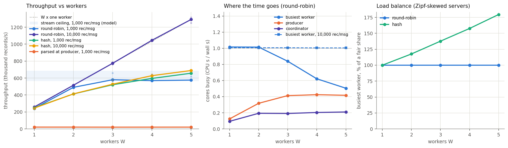
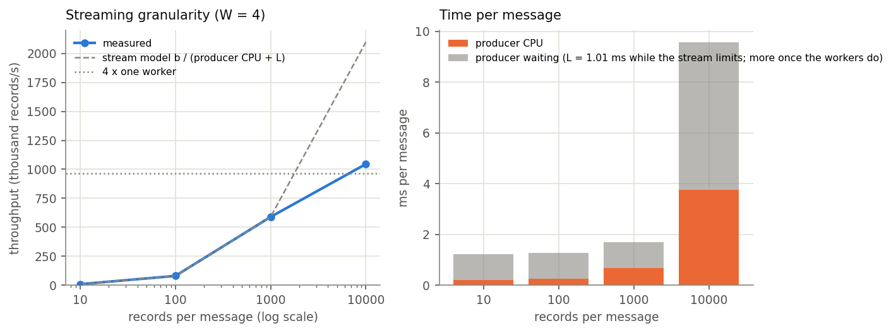
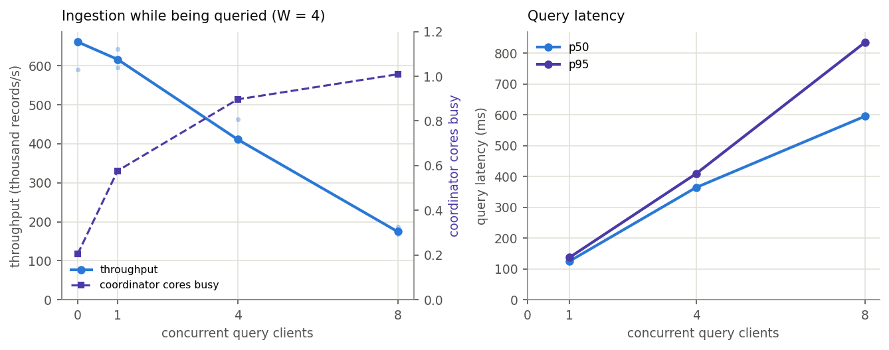
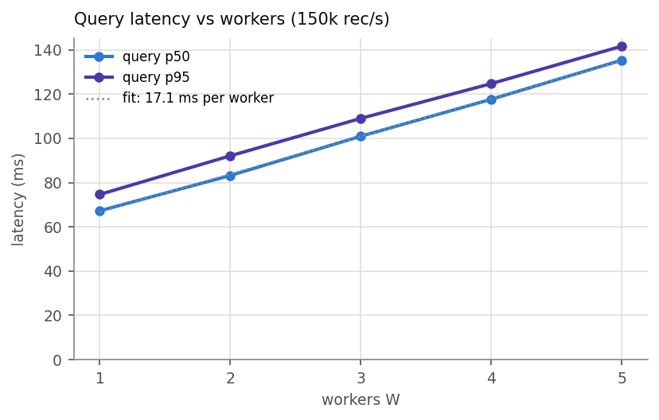
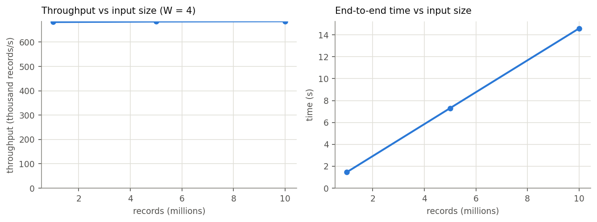

# 03 - Streaming: real-time log analytics over gRPC

The same server-log analytics as [`01-mpi`](../01-mpi) and [`02-mapreduce`](../02-mapreduce), but the
data is a continuous stream. A producer replays a dataset as if the records were arriving live; a
coordinator routes them to several workers; analytics queries are answered while ingestion is still
running; and a CLI dashboard shows the live state. After the whole stream has been processed, the
report is byte-identical to the sequential C++ reference.

## Architecture

```
                                     +--------------+
 producer.py --stream RecordBatch--> |              |--stream RecordBatch--> worker.py  w0
 (replays the dataset)               | coordinator  |----------------------> worker.py  w1
                                     |    .py       |----------------------> worker.py  ...
 dashboard.py --GetAnalytics-------> |  routes +    |<--GetPartial-----------+
 (CLI, live)                         |  merges      |
                                     +--------------+
```

| Process | Responsibility |
|---|---|
| `producer.py` | reads the dataset and streams it as `RecordBatch` messages (raw lines by default) at a configurable rate and message size |
| `coordinator.py` | receives the stream, routes batches to workers, merges partial states on query; holds no analytics state of its own |
| `worker.py` x W | parses its batches and folds records into a partial aggregate; hands out a snapshot on request |
| `dashboard.py` | queries the coordinator on a timer and redraws a CLI panel; records its own query latency |

The interface ([`proto/analytics.proto`](proto/analytics.proto)):

```protobuf
service CoordinatorService {
  rpc StreamRecords(stream RecordBatch) returns (IngestSummary);   // client-streaming
  rpc GetAnalytics(AnalyticsRequest)    returns (AnalyticsSnapshot);
  rpc GetSystemStats(StatsRequest)      returns (SystemStats);
  rpc Reset(ResetRequest)               returns (ResetResponse);
}
service WorkerService {
  rpc ProcessBatch(stream RecordBatch)  returns (WorkerAck);       // client-streaming
  rpc GetPartial(PartialRequest)        returns (PartialState);
  rpc Reset(ResetRequest)               returns (ResetResponse);
}
```

Ingestion is client-streaming rather than one RPC per batch: a unary RPC per batch pays a new HTTP/2 stream
and a round trip every time, while one long-lived stream pays once. The coordinator-to-worker link is also a
stream, which gives backpressure. `GetSystemStats` is separate from `GetAnalytics` so the analytics message
maps one-to-one onto the report.

## Design

**Where parsing happens.** A batch carries its records either as raw log lines (`--wire raw`, default; each
worker parses) or as one structured `Record` per line (`--wire parsed`; the producer parses). Measured
per-record costs decided this: on the cluster the producer needs 0.44-0.76 us per record for `raw` but 45 us
for `parsed` (parse + build a protobuf `Record` + serialise); a worker needs 4.1 us (`raw`) or 19 us
(`parsed`). Parsing is the expensive step, so it belongs in the tier being scaled. `parsed` is kept as a
measured contrast: it caps the pipeline at the producer's speed whatever W is.

**Integer-only aggregation.** Whoever parses converts `"0.523481"` to `523481` exactly once, into int64
microseconds, never a float (`parse_rt_fast` / `parse_rt_micros` mirror `read_fixed` from `loganalytics.hpp`,
truncation rule included). Integer addition is associative and commutative, so the merged result is
bit-identical regardless of W, the distribution strategy and the batch size.

**State is O(keys), not O(records).** A worker's aggregate is sized by distinct servers, endpoints and
60-second intervals, so `GetPartial` returns the same amount of data after ten million records as after ten
thousand. This is what keeps query latency flat as the stream grows, and it is the same bound as the MPI
reduction and the MapReduce mapper output.

**Backpressure.** Each worker has a bounded queue (`--queue-depth`) feeding its sender thread. When a worker
cannot keep up, its queue fills, the coordinator stops pulling from the producer's stream, and gRPC flow
control throttles the producer. An unbounded queue would absorb the whole dataset into memory and report a
meaningless throughput.

**Record distribution (two strategies, both measured).**

| | `roundrobin` (default) | `hash` |
|---|---|---|
| Rule | whole batch to the next worker in turn | records split by `server_id % W` |
| Per-record work in the coordinator | none | read each line's server id and re-bucket it |
| Load | even by construction | follows the data's skew |

The generator's server popularity is Zipf, so under `hash` the worker owning server 0 becomes a straggler.
Busiest worker's share of an even split (5M records): 100% / 118% / 138% / 158% / 180% for W = 1..5 (always
100% for round-robin). Correctness is unaffected because the merge is associative and commutative.

**Snapshot semantics.** `GetAnalytics` fans out to all workers concurrently, so the merged snapshot is not a
globally consistent cut. Queries never block ingestion; mid-stream numbers are approximate but monotone (they
never go backwards); the final numbers are exact, because `StreamRecords` returns only after every worker
stream has been closed and acknowledged.

**Global top-K once.** Top-K and the busiest interval are global questions: a worker's local top-K is over
the records it happened to receive. Workers ship per-key totals and the coordinator ranks once, after
merging (the same reasoning as the two-stage MapReduce job).

## CLI dashboard

```bash
python3 src/dashboard.py localhost:50051 --interval 0.5
```

It redraws in place (cursor-home rather than clear-screen, to avoid flicker) and shows ingestion progress and
throughput, the full analytics block, per-worker record counts with a bar (so skew under `hash` is visible as
it happens), and rolling query latency (last / p50 / p95 / max) plus the coordinator's merge time.
[`results/demo/dashboard.txt`](results/demo/dashboard.txt) holds the 20 panels it drew while 2M records
streamed through 3 workers on 3 nodes. Flags: `--once`, `--plain` (append panels; for files or Slurm logs),
`--samples N`, `--follow`, `--latency-out F` (CSV of every sample), `--report-out F` (final report in the
reference format). It handles SIGTERM and Ctrl-C cleanly and still writes its CSV.

## How to run

Dependencies: [`requirements.txt`](requirements.txt) pins `grpcio==1.48.2`, `grpcio-tools==1.48.2` and
`protobuf==3.19.6`, the versions the committed `src/analytics_pb2*.py` stubs were generated with and tested
on (Python 3.6 era; the code needs only Python 3.6, and newer Pythons work if those packages install).
`matplotlib` is needed only for `scripts/plot.py`. On the cluster used here, the module Python could not
import `grpc`, but the system `/usr/bin/python3` (3.6.8) could, so the job scripts use that
(`export PYTHON=/usr/bin/python3`); on your cluster, point `PYTHON` at any interpreter that can import `grpc`.

```bash
pip install -r requirements.txt
bash scripts/build_proto.sh     # regenerates src/analytics_pb2{,_grpc}.py if grpcio-tools exists; otherwise keeps the committed stubs
```

Stubs from a newer grpcio-tools may fail to import under an older protobuf, so regenerate them on the
machine that will run them, or keep the committed ones.

**On one machine (a laptop), no Slurm needed:**

```bash
python3 src/worker.py 0.0.0.0:50100 --worker-id w0 &
python3 src/worker.py 0.0.0.0:50101 --worker-id w1 &
python3 src/coordinator.py 0.0.0.0:50051 --workers localhost:50100,localhost:50101 &

python3 scripts/gen_logs.py -n 1000000 -o data/logs.txt -k 10 --servers 64 --endpoints 512 --seed 42
python3 src/dashboard.py localhost:50051 --interval 0.5 &
python3 src/producer.py localhost:50051 --input data/logs.txt --batch 1000 --rate 100000 --report out.txt
```

Producer knobs: `--batch` (records per message), `--rate` (records/s, 0 = unthrottled), `--wire raw|parsed`.
Coordinator knobs: `--distribution roundrobin|hash`, `--queue-depth`. Verify the result against the reference
with `g++ -O3 -std=c++17 -o src/loganalytics_seq src/loganalytics_seq.cpp && ./src/loganalytics_seq data/logs.txt ref.txt && diff ref.txt out.txt`.

Correctness suite (starts its own clusters on local ports): `bash scripts/verify.sh` (`WIRE=parsed` for the
other wire format).

**On a Slurm cluster** (partition, node counts and module/Python setup are cluster specific; the scripts
use `--partition=debug`):

```bash
sbatch slurm/verify.slurm       # correctness suite, both wire formats (1 node)
sbatch slurm/demo.slurm         # the demo, every process started by the script (5 nodes)
sbatch slurm/benchmark.slurm    # every experiment below -> results/benchmark.csv (~1 h)
sbatch --export=ALL,EXPS="workers_b10k distribution_b10k" slurm/benchmark.slurm   # a subset
python3 scripts/plot.py         # on a machine with matplotlib -> results/summary.md + figures
```

`benchmark.slurm` reuses the datasets from `../02-mapreduce/data/` when present (same generator, same seed,
same bytes).

### Cluster demo (by hand, one terminal per process)

`demo.slurm` runs the whole demo unattended (dashboard in `--plain` mode, result diffed against the
reference, output kept in `results/demo/`). To run it by hand and watch the dashboard redraw live, allocate 4
nodes and let `scripts/demo_env.sh` compute the port (`50000 + JOB_ID % 10000`) and node names once:

```bash
salloc --nodes=4 --ntasks-per-node=1 --time=02:00:00     # terminal 0; keep it open
bash scripts/demo_env.sh                                  # writes ~/.stream_demo_env and cd's to the repo when sourced
```

In each other terminal on the login node, run `. ~/.stream_demo_env` first, then:

```bash
# terminals 1-3: workers (one per node)
ssh -t $N2 '. ~/.stream_demo_env; $PYTHON src/worker.py 0.0.0.0:$PORT --worker-id w0'     # likewise $N3 / w1, $N4 / w2
# terminal 4: coordinator (after the workers are listening)
ssh -t $N1 '. ~/.stream_demo_env; $PYTHON src/coordinator.py 0.0.0.0:$PORT --workers $N2:$PORT,$N3:$PORT,$N4:$PORT'
# terminal 5: dashboard
ssh -t $N1 '. ~/.stream_demo_env; $PYTHON src/dashboard.py $N1:$PORT --interval 0.5 --follow'
# terminal 6: producer, then check against the sequential reference
ssh $N1; . ~/.stream_demo_env
$PYTHON scripts/gen_logs.py -n 2000000 -o data/logs_2000000.txt -k 10 --servers 64 --endpoints 512 --seed 42
g++ -O3 -std=c++17 -D_FILE_OFFSET_BITS=64 -o src/loganalytics_seq src/loganalytics_seq.cpp
./src/loganalytics_seq data/logs_2000000.txt data/reference_2000000.txt 2>/dev/null
$PYTHON src/producer.py $N1:$PORT --input data/logs_2000000.txt --batch 1000 --rate 100000 --report /tmp/streamed.txt --progress 0
diff data/reference_2000000.txt /tmp/streamed.txt && echo "byte-identical to the sequential program"
```

Servers bind to `0.0.0.0` and clients dial a node's hostname, never `localhost`. At `--rate 100000` the
stream lasts about 20 s, so the totals can be watched rising while it runs. Add `--distribution hash` to the
coordinator to see the worker bars become unequal; drop `--rate` to finish in about 4 s.

The coordinator serves one stream per start: it opens its stream to each worker once and nothing reopens it,
so a second producer run against the same processes would stall (read from the code, not tested; the verify
and benchmark scripts start a fresh cluster for every run). To run again, restart the workers, coordinator and
dashboard.

## Correctness

| Check | Result |
|---|---|
| `slurm/verify.slurm`, one node | **53 / 53** (`raw`) and **29 / 29** (`parsed`) |
| `slurm/demo.slurm`, coordinator + producer + dashboard on one node, workers on three others, run twice on different nodes | final report **byte-identical** to the sequential program both times; 20 live dashboard panels during a 20 s stream |
| every benchmark run | **113 / 113** byte-identical (`correct` column of [`results/benchmark.csv`](results/benchmark.csv)) |
| laptop, Python 3.6 + grpcio 1.48.2 + protobuf 3.19.6 | 53 / 53 and 29 / 29 |

The claim is that the analytics produced by streaming a dataset through W workers are byte-identical to the
output of the sequential C++ program on the same dataset, for every worker count, distribution strategy, batch
size and both wire formats. `verify.sh` has four groups: (1) the four hand-computed fixtures at every W; (2) four
generated datasets vs `loganalytics_seq` at every W x strategy; (3) invariance across W x {roundrobin, hash} x
batch in {1, 100, 5000}; (4) live queries served during ingestion, totals monotone, final answer still exact:

```
PASS  22 analytics queries served WHILE ingesting (p95 105.2 ms, 23 total)
PASS  running total never decreased across 23 queries
PASS  final report is exact despite concurrent querying
```

**A failed run, and what it was.** An earlier run of the suite failed two cases (`skewed [W=4 hash]` returned a
different report, and a parsed-wire producer got `UNIMPLEMENTED: Method not found`). Six reruns of the failing
configuration on other ports passed ([`results/logs/repro_hash_w4.txt`](results/logs/repro_hash_w4.txt)), and the
routing, folding and merge logic reproduces the reference byte for byte without gRPC. The likely cause is a port
shared with another user's gRPC server (gRPC binds with `SO_REUSEPORT`, so a second server on the same port binds
without error and connections are split between the two, silently losing one worker's share). `verify.sh` now
takes ports from a block outside 50000-59999, where job-derived ports of other users fall, and skips any port that
is already accepting connections. The cause was not proven.

**The demo, analysed** ([`results/demo/`](results/demo/)): 20 samples, one per ~1.1 s; records folded rise by
110,000-112,000 between consecutive mid-stream samples (the producer's `--rate` of 100,000/s); totals never
decreased; mid-stream query latency min 94 / p50 103 / p95 113 / max 120 ms, of which 96% is the coordinator
merging three snapshots; load balance 667,000 / 667,000 / 666,000; 2,000,000 records in 20.003 s at
`--rate 100000` (pacing accurate to 0.02%); `reference.txt`, `producer_report.txt` and `dashboard_report.txt` are
identical. The pipeline ran at about 15% of what three workers can fold: the demo shows the system is live and
exact, not how fast it is.

## Performance evaluation

Setup: coordinator, producer and query clients on one node; one worker per other node, so W is the only thing
that moves (6 nodes, W <= 5). Software: Python 3.6.8, grpcio 1.48.2, protobuf 3.19.6 with the **pure-Python
protobuf backend**. Defaults: `raw` wire, round-robin, 1,000 records per message, unthrottled, 5M records.
2-3 repetitions per configuration, interleaved; medians below. Datasets: `scripts/gen_logs.py ... --seed 42`,
N = 1M, 2M, 5M, 10M, the same files as the other parts. Every run's report was diffed against the sequential
program (113 / 113 identical). Throughput is records divided by the wall time of the whole client-streaming RPC,
so it includes every backpressure stall. "Cores busy" is a process's CPU time during the stream divided by the
stream's wall time (a Python process limited by its own code sits near 1.0 because of the GIL), which measures
which component limits each run. Full tables: [`results/summary.md`](results/summary.md).

### Predicted vs measured

| Experiment | Varies | Measured |
|---|---|---|
| `workers` | W = 1..5 | 242k to 490k records/s (2.03x), then flat at 570-580k from W = 3; workers go from 1.0 to 0.5 cores busy |
| `workers_b10k` | W, 10,000 records/msg | 258k / 515k / 774k / 1.05M / **1.29M**: 1.00 / 2.00 / 3.00 / 4.05 / **5.00x**, workers at 1.00 cores busy |
| `wire` | W, producer parses | **21k at every W**, producer 0.97 cores busy |
| `distribution`, `distribution_b10k` | W, `hash` | busiest worker saturated at every W; 412k to 657k (1,000/msg), 413k to 689k (10,000/msg), within 1-6% of the straggler model; 20-47% below round-robin at 10,000/msg |
| `batch` | 10 .. 10,000 records/msg | 8k, 80k, 589k, 1.05M |
| `queries` | 0, 1, 4, 8 clients | 662k, 617k, 411k, 175k; p50 125, 364, 595 ms; coordinator 0.20 to 1.01 cores |
| `latency` | W at a fixed 150k rec/s | p50 67 to 135 ms, **+17.1 ms per worker** |
| `size` | N = 1M, 5M, 10M | constant: 682k, 684k, 685k |

### One model explains every throughput number

Each message on the producer's stream costs the producer's own CPU time for that message **plus a fixed
L = 1.01 ms, one after the other** (gRPC Python's synchronous client stream pulls the next message only after the
previous send has completed). From the `batch` experiment:

| records / message | time per message | producer CPU per message | remainder |
|---:|---:|---:|---:|
| 10 | 1.210 ms | 0.209 ms | **1.001 ms** |
| 100 | 1.257 ms | 0.254 ms | **1.003 ms** |
| 1,000 | 1.698 ms | 0.685 ms | **1.013 ms** |
| 10,000 | 9.568 ms | 3.753 ms | 5.815 ms (the workers are now the limit) |

The remainder is the same ~1.0 ms whether a message carries 400 bytes or 40 KB, so it is a per-message cost:

```
throughput(W, b) = min( W x r_w ,  b / (b x c_p + L) )
                        workers       the single stream
    r_w = 250k rec/s per worker       L = 1.01 ms      c_p = producer CPU per record
```

Predicting each of the 30 runs where the stream is the limit from its own measured `c_p` and the median L gives a
mean error of **0.3%, worst 1.2%**. L is a fitted residual (constant across runs at 0.998-1.017 ms); its cause is
attributed to gRPC Python's synchronous client stream but was not isolated on a bare stream.

### Throughput vs number of workers



| W | 1,000 rec/msg (min-max) | speed-up | busiest worker (cores) | 10,000 rec/msg (min-max) | speed-up |
|---:|---|---:|---:|---|---:|
| 1 | 242k (240k-250k) | 1.00x | 1.02 | 258k (257k-260k) | 1.00x |
| 2 | 490k (485k-501k) | 2.03x | 1.01 | 515k (498k-516k) | 2.00x |
| 3 | 580k (566k-659k) | 2.40x | 0.84 | 774k (760k-786k) | 3.00x |
| 4 | 570k (568k-641k) | 2.36x | 0.62 | 1.05M (1.04M-1.05M) | 4.05x |
| 5 | 576k (575k-617k) | 2.38x | 0.50 | **1.29M** (1.25M-1.31M) | **5.00x** |

- At W = 1, 2 the workers are the limit (throughput is W x 250k). At W >= 3 the single producer-to-coordinator
  stream is the limit (about 565-690k records/s at 1,000 records per message, depending on the producer's CPU cost
  per record at the time), and the coordinator stays at ~0.2 cores.
- This is Amdahl's law with the single stream as the serial part, and the model says how to move the knee: fewer,
  larger messages. With 10,000 records per message the same code and cluster scale to 5.00x at W = 5 with every
  worker saturated. The cost is freshness: a record is visible to queries only once its message has been folded.
- **Where parsing happens:** with `parsed` the producer is saturated at every W (0.97 cores, 45 us per record), so
  throughput is flat at 21k; putting the per-record work in the scaled tier is worth **27x** higher throughput
  (576k vs 21k records/s at W = 5). The gap is larger than on a laptop (4.4x) because the cluster's protobuf is the
  pure-Python build.
- **Hash vs round-robin** (10,000 rec/msg): hash is 20% to 47% slower as W grows from 2 to 5, because the worker
  owning the popular servers is saturated at every W (model: 250k x W / share).



### Queries during ingestion (W = 4)



| query clients | 0 | 1 | 4 | 8 |
|---|:---:|:---:|:---:|:---:|
| ingestion throughput | 662k | 617k (-7%) | 411k (-38%) | 175k (-74%) |
| query latency p50 / p95 | - | 125 / 137 ms | 364 / 409 ms | 595 / 834 ms |
| coordinator, cores busy | 0.20 | 0.58 | 0.90 | **1.01** |

A query makes every worker snapshot its state and makes the coordinator decode and merge W partial states, all in
Python under the coordinator's GIL, which is also the thread receiving the stream. By 8 clients the coordinator is
saturated and queries and ingestion compete for one core. The answer is still exact in every run: queries never
block ingestion, but they compete with it for CPU. One client (-7%) is inside the run-to-run noise.

### Query latency vs number of workers (fixed 150k rec/s)



| W | 1 | 2 | 3 | 4 | 5 |
|---|:---:|:---:|:---:|:---:|:---:|
| query p50 | 67 ms | 83 ms | 101 ms | 118 ms | 135 ms |
| query p95 | 75 ms | 92 ms | 109 ms | 125 ms | 142 ms |
| coordinator, cores busy | 0.18 | 0.28 | 0.37 | 0.44 | 0.50 |

Latency grows linearly, **+17.1 ms per worker** (least-squares fit): the workers build snapshots in parallel, but
the coordinator decodes each partial state in Python, serialised by its GIL, before merging. This is the cost of
ranking only after merging all partials.

### Input size (W = 4)



Throughput is flat at ~684k records/s for 1M, 5M and 10M records, and time is proportional to N (1.47 s, 7.31 s,
14.59 s): worker state is O(keys), so nothing slows down as the stream grows.

### The environment: pure-Python protobuf

The cluster's protobuf 3.19.6 was the pure-Python build and could not be changed. Measured on a laptop with the same
Python 3.6 + protobuf 3.19.6, switching only the backend (`scripts/pbcost.py`, 200,000 records):

| operation | C++ backend | pure Python | |
|---|---:|---:|---:|
| parsed-wire producer (parse + build + serialise a `Record`) | 3.9 us / rec | 27.7 us / rec | 7x |
| worker: parse + fold a raw batch | 2.6 us / rec | 2.4 us / rec | 1x |
| worker: build a snapshot (2,017 entries) | 2.4 ms | 26 ms | 11x |
| coordinator: decode one worker's snapshot | 0.7 ms | 11.8 ms | 16x |

The raw wire format barely touches protobuf per record, so ingestion is unaffected; the parsed wire format and the
queries pay the full cost. The query-interference result belongs to this environment.

### Limitations

- The plateau is a range, not a number: the same configuration gave 570k to 684k in different experiments because
  the producer's CPU per record ranged from 0.44 to 0.75 us between runs of identical work (the node was probably
  shared; this is inferred from the CPU spread, not measured). The knee at W = 3 is robust.
- The ~2.1M rec/s stream capacity at 10,000 records per message is an extrapolation, since the workers cap that
  experiment at 1.29M.
- In `latency` at W = 4 the final merge took 0.19-0.20 s against 0.09 s at W = 3 and 0.14 s at W = 5, an unexplained
  outlier (the p50 and the slope are unaffected).
- Memory was not measured; it is bounded by design (O(keys) per worker, at most `--queue-depth` batches queued per
  worker).
- No fault tolerance: a dead worker or coordinator ends the run. The coordinator serves one stream per start.

## Files

```
proto/analytics.proto         both services and every message
src/aggregate.py              parsing, folding, merging, report rendering
src/analytics_pb2*.py         generated stubs (committed; regenerate with scripts/build_proto.sh)
src/worker.py                 one partial aggregate, behind a lock
src/coordinator.py            routing, backpressure, merge, ranking
src/producer.py               replays the dataset as a stream
src/dashboard.py              CLI dashboard + query-latency recorder
src/loganalytics.hpp, loganalytics_seq.cpp   shared C++ reference (the correctness oracle)
scripts/                      build_proto.sh, gen_logs.py, verify.sh, benchmark.sh, demo_env.sh, pbcost.py, plot.py
slurm/                        verify.slurm, demo.slurm, benchmark.slurm
tests/                        hand-computed fixtures
results/                      benchmark.csv, summary.md, figures, logs/repro_hash_w4.txt, demo/ (dashboard panels, latencies, reports)
```
