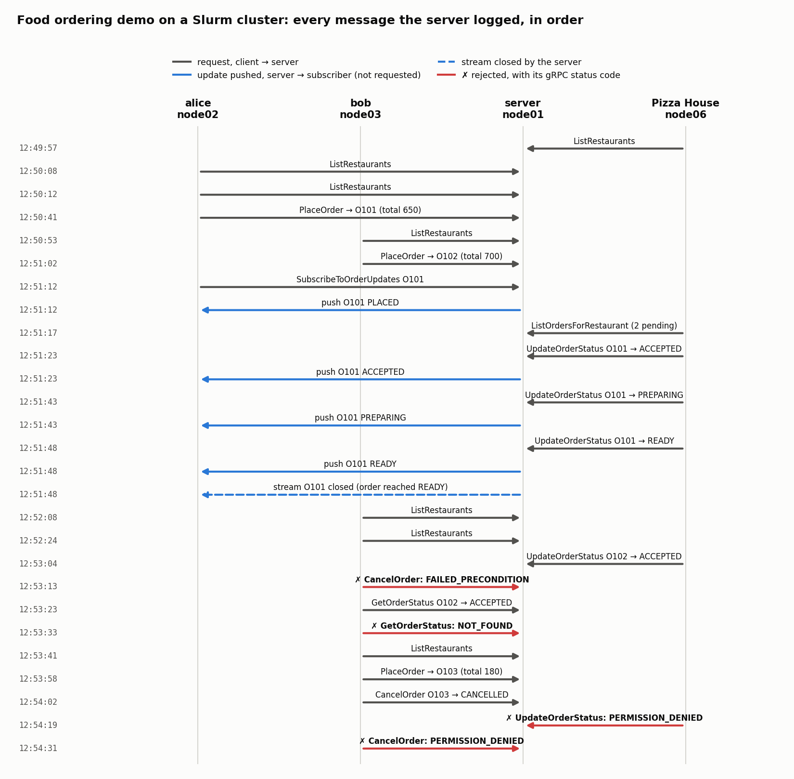

# 04 - Service: food ordering over gRPC

The stateful-service part of the project: a simplified Swiggy-style ordering service in Python and gRPC. One
server holds restaurants, menus and every order; any number of customer and restaurant clients talk to it;
and customers receive real-time order updates over a server-streaming RPC. Where the other parts push a
data stream through stateless aggregation, this one is about shared mutable state: validated state
transitions, ownership checks, and consistency under concurrent clients.

## Overview

A central **Food Ordering Server** holds a fixed set of restaurants and menus and the state of every order.
**Customer clients** list restaurants, place orders, check and track them, and cancel them. **Restaurant
clients** see their pending orders and move each one through its lifecycle:

```
PLACED -> ACCEPTED -> PREPARING -> READY
PLACED -> CANCELLED
```

The server rejects invalid transitions and other error cases with proper gRPC status codes, pushes status
changes to subscribed customers without polling, and stays consistent when many clients act at once.

```
                         +--------------------------------+
                         |   Food Ordering Server          |
                         |   server.py  (0.0.0.0:<PORT>)   |
                         |  RESTAURANTS  (fixed menus)     |
                         |  orders {id -> Order}           |
                         |  one lock guarding all orders   |
                         |  per-order subscriber queues    |
                         +-----^-------------^--------+----+
             ListRestaurants   |             |        |  stream OrderUpdate
             PlaceOrder        |             |        |  (pushed on every
             GetOrderStatus    |             |        |   status change)
             CancelOrder       |             |        v
             SubscribeTo...    |     UpdateOrderStatus
                         +-----+-------+   ListOrdersForRestaurant
                         | customer.py |   +---------------+
                         | (alice, bob)|   | restaurant.py |
                         +-------------+   +---------------+
```

| Process | Role |
|---|---|
| `server.py [host:port]` | the only holder of state; a `grpc.server` with a 64-thread pool. Without an address it binds `0.0.0.0:50051` |
| `customer.py <server> [customer_id]` | menu-driven CLI: List Restaurants, Place Order, Check Order Status, Track Order, Cancel Order |
| `restaurant.py <server> "<restaurant name>"` | menu-driven CLI: View Pending Orders, Accept Order, Start Preparing, Mark Ready. Checks the name against the server's restaurants at start-up |

Restaurants: Pizza House (Margherita Pizza 250, Farmhouse Pizza 350, Garlic Bread 150) and Burger Point
(Veg Burger 180, Cheese Burger 220, French Fries 120).

## The gRPC interface (`proto/food_ordering.proto`)

| RPC | Kind | Used by | Purpose |
|---|---|---|---|
| `ListRestaurants` | unary | customer, restaurant | all restaurants with their items and prices |
| `PlaceOrder` | unary | customer | validates customer id, restaurant, items and quantities, computes the total, assigns a unique id, status `PLACED` |
| `GetOrderStatus` | unary | customer | current status, restaurant and total of one order |
| `UpdateOrderStatus` | unary | restaurant | moves an order to its next state; carries the restaurant's name so ownership can be checked |
| `SubscribeToOrderUpdates` | **server streaming** | customer | the current status immediately, then one message per change; ends at `READY` or `CANCELLED` |
| `CancelOrder` | unary | customer | allowed only while `PLACED` and only by the customer who placed the order |
| `ListOrdersForRestaurant` | unary | restaurant | the calling restaurant's orders that are still `PLACED`, `ACCEPTED` or `PREPARING` |

Interface choices: `CancelOrder` and `ListOrdersForRestaurant` are separate RPCs rather than overloads of
`UpdateOrderStatus`, which keeps the permission model simple (restaurants only move orders forward, only
customers cancel). Customers have an identity: `PlaceOrder` requires a `customer_id`, stored with the order,
and `CancelOrder` succeeds only for the customer who placed it (`customer.py` sends the name given on its
command line, or a unique `guest-xxxxxx` id). This is identification, not authentication. Order ids are
`O101`, `O102`, ...; status is a string so the CLIs print it directly.

## Server design

**Order lifecycle.** The allowed restaurant transitions are a single map. `UpdateOrderStatus` succeeds only if
the requested status is exactly the next one for the order's current state; going backwards, skipping a step,
repeating one, an unknown status, or touching a finished order all fail with `FAILED_PRECONDITION`.
`CANCELLED` is reachable only through `CancelOrder`, only from `PLACED`, and only by the order's owner.

**Concurrency.** One `threading.Lock` guards the order table and every order's state. An update checks
ownership, checks the transition and applies it inside one critical section, so two restaurants, or a customer
and a restaurant, racing on the same order cannot both succeed. Order ids come from a counter read under the
same lock, so concurrent customers never receive the same id. Validation of restaurant, items and quantities
happens before taking the lock (menus are read-only). One global lock is enough at this scale: every critical
section is a few dictionary operations.

**Real-time updates.** Each `SubscribeToOrderUpdates` call gets its own `queue.Queue`. Under the lock, the
current status is put in the queue and the queue is registered on the order, so the snapshot and the
registration are atomic and no update can fall between them. Every status change puts the new status into every
registered queue while still holding the lock, so every subscriber sees changes in the order they were applied.
The stream handler yields each status as it arrives and returns after `READY` or `CANCELLED`; if the client
disconnects, the handler notices within 1 s (it waits on the queue with a timeout and checks
`context.is_active()`) and unregisters. Each open stream occupies one server thread, so the pool size bounds how
many orders can be tracked at once: with 64 threads, 30 simultaneous streams leave the server fully responsive;
with 16 threads only 16 streams open and every other request stalls (tested).

**Exception handling.** Each rejected RPC ends with `context.abort(code, message)` and never changes state.
Ownership is checked before the order's state, so a stranger's cancel is refused with `PERMISSION_DENIED`
whatever state the order is in, revealing nothing about it.

| Situation | Status code | Message |
|---|---|---|
| order from a non-existent restaurant | `NOT_FOUND` | `Restaurant 'Taco Town' does not exist.` |
| order an item the restaurant does not have | `NOT_FOUND` | `'Veg Burger' is not available at Pizza House.` |
| get / track / cancel / update a non-existent order | `NOT_FOUND` | `Order 'O999' does not exist.` |
| cancel an order already `ACCEPTED`, `PREPARING`, `READY` or `CANCELLED` | `FAILED_PRECONDITION` | `Order O102 has already been accepted and cannot be cancelled.` |
| invalid transition (backwards, skipping, repeating, unknown) | `FAILED_PRECONDITION` | `Invalid order state transition: READY -> PREPARING.` |
| restaurant updates another restaurant's order | `PERMISSION_DENIED` | `Order O103 does not belong to 'Pizza House'.` |
| customer cancels an order placed by someone else | `PERMISSION_DENIED` | `Order O101 was placed by another customer.` |
| order with no items, or quantity <= 0 | `INVALID_ARGUMENT` | `An order must contain at least one item.` |
| order without a `customer_id` | `INVALID_ARGUMENT` | `A customer_id is required to place an order.` |

**Input checked as typed.** *Place Order* in `customer.py` fetches the menus first and validates each entry as
it is typed (unknown restaurant, item not on the menu, malformed `name,quantity`, non-positive quantity), asking
again instead of waiting for submission. The server still validates every order in full and remains the
authority; a client that skips these checks, like `verify.py`, gets the server's gRPC codes.

**Server log.** The server prints one timestamped line per event, naming the node that made each request:
every request, every state change (with how many subscribers were notified), every update pushed down a stream,
streams opening and closing, and every rejection with its gRPC code. For example:

```
12:50:41.685 [Server] PlaceOrder from node02: O101 placed by 'alice' at Pizza House: Margherita Pizza x2, Garlic Bread x1, total 650, status PLACED
12:51:12.340 [Server] SubscribeToOrderUpdates from node02: stream opened for O101 (currently PLACED, 1 subscriber(s))
12:51:23.622 [Server] UpdateOrderStatus from node06: O101 PLACED -> ACCEPTED by 'Pizza House' (notified 1 subscriber(s))
12:51:23.655 [Server]   pushed O101 ACCEPTED to node02
12:54:31.917 [Server] REJECT CancelOrder from node03: PERMISSION_DENIED: Order O101 was placed by another customer.
```

## How to run

Dependencies: `pip install -r requirements.txt` (grpcio, grpcio-tools; `matplotlib` only for
`scripts/plot_demo.py`). The committed stubs (`src/food_ordering_pb2*.py`) were generated with grpcio-tools
1.48.2 and were run under protobuf 3.19.6 (pure-Python backend) and under current releases. Check them with:

```bash
python3 -c "import sys; sys.path.insert(0, 'src'); import food_ordering_pb2, food_ordering_pb2_grpc; print('stubs OK')"
```

Regenerate them only if that fails or the `.proto` changes, ideally with the same grpcio-tools version as the
target environment (stubs from a newer grpcio-tools can fail to import under an older protobuf):

```bash
python3 -m grpc_tools.protoc -Iproto --python_out=src --grpc_python_out=src proto/food_ordering.proto
```

**On one machine (three terminals in this folder):**

```bash
python3 src/server.py localhost:50051                        # terminal 1
python3 src/customer.py localhost:50051 alice                # terminal 2
python3 src/restaurant.py localhost:50051 "Pizza House"      # terminal 3
```

**On a Slurm cluster** (module and Python setup are cluster specific; the interpreter must be able to import
`grpc`). Allocate nodes with `salloc --nodes=4 --ntasks-per-node=1`, pick a port (for example
`$((50000 + SLURM_JOB_ID % 10000))`, so each allocation gets its own), and start each program in its own
terminal after `ssh`-ing to a node of the allocation:

```bash
python3 src/server.py 0.0.0.0:<PORT>                         # node01: bind 0.0.0.0, NOT localhost
python3 src/customer.py node01:<PORT> alice                  # node02
python3 src/customer.py node01:<PORT> bob                    # node03
python3 src/restaurant.py node01:<PORT> "Pizza House"        # node04
```

Clients always dial the server node's hostname, never `localhost`. Common problems: `Address already in use`
(use another free port above 1024 in all terminals); a client hanging or printing `UNAVAILABLE` (wrong host or
port, or the server bound `localhost`); `ModuleNotFoundError: No module named 'grpc'` (a Python module that lacks
grpc is loaded); `Address family not supported by protocol ... [::]` (gRPC also tries IPv6, harmless).

### Walk-through

Start a fresh server so ids begin at `O101` (order ids begin with the capital letter O). Then:

| # | Terminal | Type | Expected |
|---|---|---|---|
| 1 | alice | `1` (List Restaurants) | both restaurants with prices |
| 2 | alice | `2`, `Pizza House`, `Margherita Pizza,1`, `Garlic Bread,2`, then Enter on an empty line | `Order ID: O101`, `Total: 550`, `Status: PLACED` |
| 3 | bob | `2`, `Pizza House`, `Farmhouse Pizza,2`, Enter | `Order ID: O102`, `Total: 700` |
| 4 | alice | `4` (Track Order), `O101` | `[Update] Order O101 : PLACED` |
| 5 | restaurant | `1` (View Pending Orders) | `O101` and `O102`, both `PLACED` |
| 6 | restaurant | `2` `O101` (Accept), `3` `O101` (Start Preparing), `4` `O101` (Mark Ready) | `ACCEPTED`, `PREPARING`, `READY` |
| 7 | alice | watch | the same three updates appear on their own: real-time updates |
| 8 | restaurant | `3`, `O101` | `[Error] FAILED_PRECONDITION: Invalid order state transition: READY -> PREPARING.` |
| 9 | bob | `2`, `Taco Town` | rejected at once by the client, with the valid names listed |
| 10 | restaurant | `2`, `O102` (accept bob's order) | `O102 : ACCEPTED` |
| 11 | bob | `5` (Cancel Order), `O102` | `[Error] FAILED_PRECONDITION: Order O102 has already been accepted and cannot be cancelled.` |
| 12 | bob | `3` (Check Order Status), `O999` | `[Error] NOT_FOUND: Order 'O999' does not exist.` |
| 13 | bob | `5`, `O101` (alice's order) | `[Error] PERMISSION_DENIED: Order O101 was placed by another customer.` |

## Verification

`scripts/verify.py` is a scripted client that checks the whole system against a live, freshly started server:

```bash
python3 src/server.py 0.0.0.0:<PORT>                 # on the server node
python3 scripts/verify.py node01:<PORT>              # from another node (or localhost:<PORT> locally)
```

| Group | Checks | What they establish |
|---|---:|---|
| 1. Listing | 3 | both restaurants, every item and price |
| 2. Placing | 6 | the example total (1 Margherita + 2 Garlic Bread = 550); status `PLACED`; unique ids; `GetOrderStatus`; the same item on two lines adds up |
| 3. Processing + streaming | 9 | pending list, no leak between restaurants; `ACCEPTED -> PREPARING -> READY`; a subscriber receives exactly `PLACED, ACCEPTED, PREPARING, READY` and the stream closes; a late subscriber gets the current state at once |
| 4. Cancellation + ownership | 10 | another customer's cancel, and a cancel with no customer id, get `PERMISSION_DENIED` and leave the order unchanged; the owner's cancel succeeds and reaches the subscriber; a cancelled order cannot be accepted or cancelled again |
| 5. Exceptions + validation | 26 | every row of the exception table with its exact status code, plus empty order id, `0101` typed for `O101`, unknown status, an update claiming a non-existent restaurant, negative quantity, ownership checked before state, failed requests leaving the order untouched |
| 6. Concurrency | 5 | 20 customers x 10 orders in parallel give 200 unique ids; 10 simultaneous `ACCEPTED` give exactly one winner; cancel racing accept gives exactly one winner; 3 subscribers on one order all receive the full sequence |
| 7. Stream limits | 4 | 30 orders tracked at once while other requests are answered within 1 s; all 30 streams close on `CANCELLED`; a client disconnecting mid-stream does not disturb another subscriber |

3 + 6 + 9 + 10 + 26 + 5 + 4 = **63 checks, 63 / 63 passed** on a Slurm cluster (server on one node, `verify.py`
on another; the server logged all 385 requests as coming from the second node, including the 46 deliberate
rejections, and the suite took 2.6 s), on a laptop with the cluster's exact versions (grpcio 1.48.2, protobuf
3.19.6, pure-Python backend), and on a laptop with current releases. The tests are sensitive to the flaws they
target: with the thread pool set to 16, group 7 fails (only 16 of 30 streams open and the server stops
answering). The raw verification logs are not included in this repository.

## Demo run

A four-node run (server on node01, customers alice and bob on node02 and node03, restaurant Pizza House on
node06) was logged by the server and turned into a message-sequence diagram by
`python3 scripts/plot_demo.py <server_demo.log> results/demo_sequence.png`. Each row is one logged event: grey is
a client's request, blue an update the server pushed without being asked, red a rejection labelled with its gRPC
code.



What the run shows:

- Four processes on four nodes, one server; every request in the log carries the node it came from.
- alice placed `O101` and bob `O102` from different nodes, and the restaurant saw both in its pending list.
- alice subscribed once. Each of the restaurant's three status changes was pushed to her 33 ms, 23 ms and 7 ms
  after the server applied it (the gap between each `UpdateOrderStatus` line and the `pushed ... to node02` line
  after it), and the stream closed itself at `READY`. She sent no further requests.
- Rejections, each with its gRPC code: bob's cancel of the accepted `O102` (`FAILED_PRECONDITION`), a status
  query for a non-existent order (`NOT_FOUND`), the restaurant's update of another restaurant's order
  (`PERMISSION_DENIED`), and bob's cancel of alice's order (`PERMISSION_DENIED`). Invalid restaurant and item
  names were refused on the spot by the client and never reached the server.
- The invalid-transition case (`READY -> PREPARING`) was not performed in the live demo; it is covered by
  `verify.py` group 5.

## Limitations

- State is in memory only: restarting the server loses all orders.
- One global lock and one thread per open stream: fine for this scale, not designed for thousands of subscribers.
- Customer identity is a name, not authentication.
- Single server: no replication or failover.

## Files

```
proto/food_ordering.proto      FoodOrderingService and every message
src/server.py                  restaurants, orders, lifecycle validation, cancel ownership, locking, exception handling, update streaming, event log
src/customer.py                customer CLI (identity: the name given, or guest-xxxxxx; input checked as typed)
src/restaurant.py              restaurant CLI (the name is checked at start-up)
src/food_ordering_pb2*.py      generated stubs (grpcio-tools 1.48.2)
scripts/verify.py              automated correctness checks against a live server
scripts/plot_demo.py           server log -> message-sequence diagram
results/demo_sequence.png      the figure above
```
